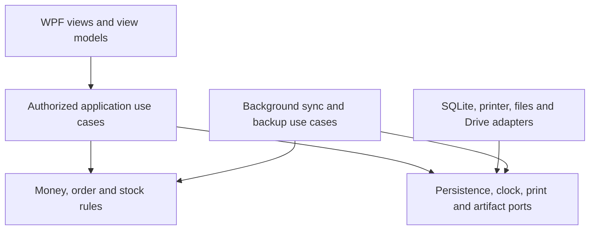

# Architecture review

Date: November 16, 2026. Source: [BRD v1.2](Maan_and_Miggys_Beachtro_POS_BRD_v1.2.md), sections 8–20, 27 and Appendix B. Status: proposed refinements for approval; no schema, code or configuration created. See [gap analysis](REQUIREMENTS_GAP_ANALYSIS.md) for G references and [decisions](OPEN_QUESTIONS_AND_DECISIONS.md) for D references.

## Architectural verdict

Retain the baseline direction: native WPF/MVVM desktop, application/domain services, SQLite/EF Core on local storage, Windows printing and asynchronous Drive exports/backups. Recommend one modular application with in-process background workers initially. Avoid initial microservices, a message broker, a running PostgreSQL server or a local HTTP API solely to anticipate expansion. The native Windows/single-terminal/offline constraints are preserved (sections 4, 10; FR-025,030).

The stack table is proposed technology, while Appendix B and sections 5/10 reinforce SQLite, service boundaries, atomic transactions and durable sync. These are not reasons to approve every unspecified implementation detail. Exact versions, money mapping, hosting, installer and worker lifecycle remain D-10, D-13, D-18.

The arrows express code dependencies; the composition root wires adapters into ports. The domain has no dependency on WPF, EF, Google APIs or printers. Background work uses its own short-lived persistence scope, never a shared UI DbContext. Reports read durable financial facts; the cart is not their source.

## Modules and dependencies

| Module | Owns / depends on | Baseline trace |
|---|---|---|
| Identity/authorization | Local password verification, active-user/session checks and permission evaluation; bootstrap/reset design pending | FR-001–003; sections 6,18 |
| Catalog | Product/category and price maintenance, immutable sale snapshots, archive rather than destructive removal of referenced products | FR-004–006; section 11 |
| Inventory | Opening/addition/correction/sale/approved-return movements and on-hand balance; depends on authorization/catalog | FR-007–008; sections 8,13 |
| Sales/payment recording | Cart validation, financial calculation, safe number allocation and one local commit; depends on catalog/inventory/security and configured policy | FR-009–015; sections 8,14 |
| Corrections | Linked void/refund events, quantity/value limits, stock disposition and tender recording | FR-018,024; sections 8,14,17–18 |
| Receipts | Render from committed snapshots, submit print jobs, track attempts/reprints; depends on sale facts and approved template | FR-016; section 16 |
| Shifts/cash | Optional initial scope decision; associates sales/refunds/movements with shift and approved expected-cash formula | FR-019–020; section 17 |
| Reports/exports | Common ledger definitions, bounded date ranges, CSV/PDF artifacts and immutable report version metadata | FR-017,021–023; sections 13,17 |
| Sync | Durable intent, payload materialization, retry/lease, remote identity and status; depends on committed snapshots/artifact storage | FR-026–027; section 15 |
| Backup/recovery | Consistent backup, manifest, retention and recovery coordination; depends on database/file adapters and authorization | FR-028; section 19 |
| Settings/audit | Effective-dated configuration, protected integration secrets, mandatory audit for protected actions | FR-024,029; sections 18,20 |

## Checkout boundary and failure behavior

Recommended sequence, resolving G-04 (sections 13–15; FR-012,026):

1. Validate signed-in active operator, permissions, order type, cart bounds, active products, approved price/tax/discount policies and payment fields. A GCash confirmation records verifier and time; it does not contact a gateway.
2. Begin a short local database transaction. Revalidate stock/current policy within this boundary. Allocate a business-day sequence under a uniqueness constraint; attach stable internal sale ID and unique checkout request ID.
3. Save order, immutable items and calculation inputs, payment applied amount/tender/change/verification, inventory balance and movements, financial audit and a durable export intent. Commit together. Do not render PDFs, call Drive or wait on a printer inside the transaction.
4. Acknowledge completion from persisted state. A repeated request resolves to the already committed sale. If outcome is uncertain after crash, inspect by request/sale identity before offering another charge.
5. Materialize recoverable export artifacts and receipt jobs from the committed record; background upload and print failure are separate from sale completion.

| Failure point | Proposed invariant / recovery |
|---|---|
| Before local commit or failed validation | No completed sale, payment ledger, stock movement or sync intent persists. GCash may nevertheless have arrived externally; D-07 recovery policy applies. |
| Crash during commit | Recovery reads SQLite outcome; UI memory does not decide whether to repeat. |
| Commit succeeds, UI acknowledgment lost | Same checkout request returns original sale, number and payment. |
| Receipt rendering/spool/physical print fails | Completed sale remains; show recoverable print status/reprint. Never initiate another checkout to print. |
| Payload missing/unwritable | Intent remains visible and retryable; regenerate versioned payload from snapshots or report an actionable local-storage fault. |
| Drive unavailable/revoked | Queue remains durable; checkout does not require network. Disk exhaustion is a local fault and cannot be ignored to promise indefinite availability. |

SQLite atomicity cannot include external GCash transfer or physical paper. Authorization and workflow make those boundaries explicit (G-06, G-15; D-07, D-16). Approval of a money-received-but-unrecorded procedure is essential.

## Data design review

The section-11 tables are logical proposals, not migration-ready definitions. Recommended design work:

| Concern | Refinement and integrity rule | Trace |
|---|---|---|
| Money | C# decimal with explicit rounding; prefer signed integer minor units for persisted rounded money after scale approval. Fractional quantities/rates may need separate exact scaled representations. Bound overflow; never use REAL/double for financial totals. Validate EF translation and report aggregates for pinned versions. | Sections 8,11; FR-006,011; G-02; D-03,10 |
| Identity | Stable internal IDs separate from human/legal number; unique transaction number, checkout request and artifact logical key. Transaction sequence table is proposed, not present in BRD. | Sections 8,14–15; G-04,12; D-12 |
| Catalog/history | Name/unit price already required snapshots; add approved currency, tax version/rate/base, discount allocation and totals. Snapshot receipt business fields/template version where needed for reprints. Preserve references when catalog changes. | Sections 11,16,20; G-02,15 |
| Referential integrity | Enable/enforce foreign keys, unique normalized usernames and role/permission keys, unique association pairs, one Inventory per product; SKU uniqueness policy pending. Block destructive cascade of financial records. | Sections 9,11,18; FR-002–008,024 |
| Bounds/status | Positive sale quantities, valid states/method/order type, bounded nonnegative applied amounts; separate signed correction deltas from sale fields. Payment sums/totals and stock reconciliation enforced in authorized transactional services and appropriate checks. | Sections 8,14; G-03,06,10 |
| Stock | Atomic conditional deduction and balance/movement write; recheck override permission. Audit opening balances and tracked/untracked changes. Snapshot tracking behavior so later catalog changes do not rewrite history. | FR-007–008,012; G-10 |
| Corrections | Proposed correction header/items/payment/stock-disposition relations to originals; enforce cumulative returned quantity/value within original eligible balance. Original line facts unchanged. | FR-018; G-03; D-04 |
| Payments | Distinct amount applied, tendered and change; verifier/verification time separate from recorder; optional GCash reference per baseline, protected logs. Multiple payment rows do not authorize split tender. | FR-013–015; G-06 |
| Shift link | Add explicit sale/payment/correction association if shifts included; close against immutable ledger and approved formula. | FR-019–020; G-07 |
| Time | Consistent UTC instant mapping plus approved timezone/business-date interpretation; tax effective period and historical snapshots. Handle midnight, clock rollback and closed days; no reliance on development machine timezone. | Sections 8,17,20; G-05,21 |
| Queue/artifacts | Unique logical artifact/version; stable payload or regenerable snapshot reference; checksum/size, remote ID, attempt, next attempt and lease ownership/expiry. State transition history and safe local paths. | FR-026–027; G-08–09 |
| Audit | Actor, action, target, reason, time, correlation ID and relevant safe before/after details; no secrets. Business correction audit committed with correction. Login failures recorded outside failed business transactions. | FR-024; section 18 |

Index transaction number, completion/business-date range, cashier/shift, order-item/product, movement/product/time and queue state/next attempt. Review query plans with representative volumes rather than indexing every field. Application checks supplement constraints; a database check cannot independently establish permission or external settlement.

## Sync and artifact lifecycle

Recommend immutable per-sale structured artifacts, plus separate daily/monthly report artifacts, as a review option (D-11). This resolves tension between near-real-time uploads and a changing daily CSV; immutable versioned batches are an alternative. Owner-approved naming is human convenience, not identity.

Proposed states: Pending → In Progress → Succeeded; transient failure returns to scheduled Pending, permanent/repeated failure becomes visible Failed with manual retry. Persist attempt history. Claim work with a bounded lease, reclaim stale work after restart, and keep worker DB transactions short. Never hold a DB lock across a network request.

Persist a remote file ID when allocated and reuse it on retries. Resolve success-with-lost-response against the same identity/content, not by creating a new filename. Checksums verify bytes; they do not provide a uniqueness lock. Google documents pre-generated IDs for retry-safe file creation; verify the chosen upload/content type and folder authorization in later integration testing. [Google file creation guidance](https://developers.google.com/workspace/drive/api/guides/create-file).

Define bounded exponential retry/jitter, handling for quota/network/server errors versus revoked access, full storage and permission failures. No internet-ping success should be required to attempt a queued upload. Show last success, oldest pending age, pending/failed counts and actionable reconnect/manual retry controls (FR-027). Preserve local records after success; cleanups follow an independent approved retention policy.

## Security and recovery boundaries

Enforce capabilities in services, including direct calls from non-UI paths. Recheck active user/permission for protected actions, prevent last-owner lockout, and distinguish technical administration from refund approval. Current-user DPAPI protection assumes an identified Windows account; an application login is not a separate DPAPI identity. Machine scope has different exposure. Token reauthorization on replacement hardware is preferable to assuming a database backup carries recoverable credentials (G-13,16; D-14,17).

Treat local administrators/malware with file access as outside ordinary app RBAC guarantees. ACLs, minimal diagnostics, controlled exports and optional recoverable backup encryption reduce exposure; do not claim an append-only table is tamper-proof. Audit integrity beyond that threat model requires an explicit decision, not silently added enterprise infrastructure.

Use supported consistent SQLite backup, create a manifest with checksum/schema/app version/last sale, validate the backup and queue it. Recovery should preserve the failed database, quiesce application/workers, inspect schema/integrity and latest known transactions, reconcile numbering and sync identity, restore/regenerate external payloads, and reauthorize Drive if needed. Resume only under approved authority. Cloud exports are not a complete database or an automatic replay stream (G-11–12).

An in-process BackgroundService does not run while its application is closed. Recommend startup catch-up and an owner-approved operating procedure initially; select a separate scheduler/service only if approved unattended execution requirements justify it (D-13). Backup and restore must cover artifacts or prove deterministic regeneration. Daily backup plus offline cloud backlog cannot guarantee a 24-hour off-site RPO.

## Printing, reporting and future migration

Render committed snapshots through a Windows printer adapter with approved layout, margins and peso glyph support. Record print/reprint intent and outcome; spooler acceptance is not proof of physical receipt. Receipt failure does not reverse a sale (FR-016; G-15).

Use one approved financial definition for UI, CSV, PDF and Drive summaries. Aggregate original sales and linked corrections using signed, explicit date treatment rather than dropping any order whose status changed. Exports need escaping, encoding, locale/decimal conventions and spreadsheet-formula handling for untrusted names/notes (FR-021–023; D-05).

Future API migration reuses application/domain boundaries and stable IDs, not local EF objects passed through WPF. Later design must address central authorization, numbering/cutover, client idempotency, concurrent stock, offline conflicts and schema/data conversion. Migration is meaningful work even with clean boundaries. Do not claim current offline single-terminal behavior solves multi-terminal disconnected selling (section 10.2,27; FR-030).
