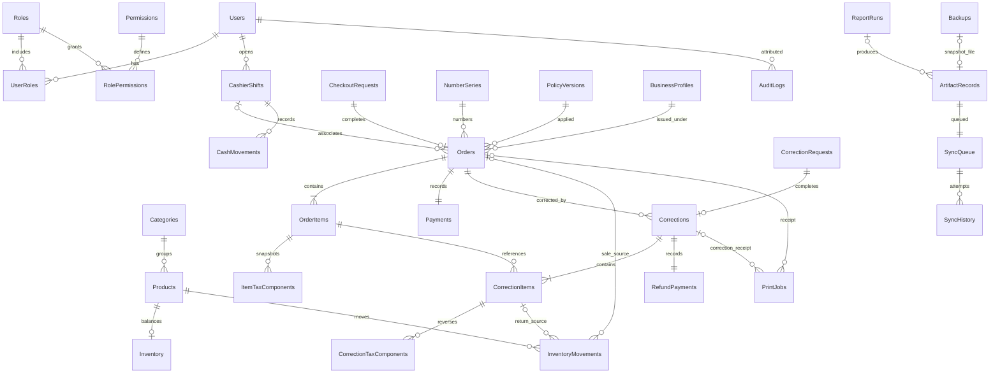

# Database design and ERD

Version 1.0 · November 16, 2026 · POS-DEC-001 · Design only; no database or migration created. Surely Win Dilag owns implementation/review. Source: [BRD](../Maan_and_Miggys_Beachtro_POS_BRD_v1.2.md) §§8–11,14–20, Appendix B; D-10 in [decision register](DECISION_REGISTER.md).

## Physical conventions

SQLite on local SSD. Each writable connection enables and verifies `foreign_keys=ON`, `busy_timeout=5000`; initialization requests and verifies `journal_mode=WAL`, `synchronous=FULL`. Keep writer gate local to process, separate read scopes and short `BEGIN IMMEDIATE`-equivalent transactions for checkout/stock/correction. FULL is chosen for stronger committed-sale durability, not a promise against defective storage. SQLite documents transaction locking and durability settings: [transactions](https://www.sqlite.org/lang_transaction.html), [pragmas](https://www.sqlite.org/pragma.html). Integration tests must read back pragmas; some are connection-specific. UI reports Busy after bounded retry with same request identity; it does not invent a new request.

All PKs unless specified: UUID generated by application, lowercase canonical TEXT length 36; use UUID v4 for portable stable identities. `Utc` suffix = signed INTEGER Unix milliseconds; `BusinessDate` = TEXT `YYYY-MM-DD` derived using stored timezone/cutoff policy. Enums = constrained TEXT with named values; booleans INTEGER CHECK 0/1. Nullable fields explicitly `?`. Fields otherwise NOT NULL. Mutable rows carry INTEGER `Version >=1` for optimistic updates. Descriptions/notes are bounded text in services (name 150, SKU 64, username 64, reason 500, reference 128); reject control characters other than allowed note newlines.

`M` = INTEGER signed minor units; currency exponent snapshot supplies scale (design fixtures use 2); per-document amounts >=0 except explicitly signed ledger deltas/movements. Product unit price M; `Q` = INTEGER thousandths of one product unit; `RatePpm` INTEGER millionths (100000 = 10%). `UnitStepQ` either 1000 (whole) or 1 (fractional) initially, configured per product. Use checked arithmetic/decimal intermediate; no money REAL column or float conversion. Store exact calculation-policy JSON as canonical UTF-8 TEXT; no locale-dependent decimal string. Rates/quantities/currency remain explicit structured fields.

Application upper bounds: quantity/cart 1000000 units per product, money/document 100000000000 minor units, 100 lines/cart, rate 0..1000000 for initial single-rate policy, currency exponent 0..4. Reject checked intermediate overflow and unsupported policy combinations. Bounds are selected safety limits, not business sales-volume promises; revise prospectively with tests if real catalog needs differ. Money aggregate/report processing uses checked 64-bit sums and detects overflow rather than wrapping. Referential delete behavior is RESTRICT for financial/history references; archive master data, never cascade-delete ledger rows.

## Entity relationship diagram

Orders/Corrections also have globally stable references in artifact `SourceType/SourceId`; application dispatches by type rather than a fake polymorphic FK. For Sale/Correction types add dedicated nullable FK columns with XOR checks and equality to SourceId. ERD omits some actor/configuration edges for readability; dictionary is authoritative.

## Data dictionary

### Identity and configuration

| Table | Columns beyond PK | Keys/checks and behavior |
|---|---|---|
| Users | Username, NormalizedUsername, DisplayName, PasswordHash, IsActive, MustChangePassword, FailedCount, LockedUntilUtc?, SecurityVersion, CreatedUtc, UpdatedUtc, Version | Unique NormalizedUsername; counters >=0. PasswordHash includes algorithm/version/salt/work factor from maintained hasher. No plaintext/reset password column. |
| Roles | Key, Name, Description, Version | Unique immutable Key. Owner/Cashier/Manager/Administrator templates, multiple assigned roles union capabilities. No inherent technical-admin financial bypass. |
| Permissions | Key, Description | Unique immutable Key; see security matrix. |
| UserRoles | UserId, RoleId | Composite PK, FKs; no separate UUID needed. |
| RolePermissions | RoleId, PermissionId | Composite PK/FKs. Updates increment affected users' SecurityVersion in same transaction. |
| PolicyVersions | Kind, Revision, EffectiveFromUtc, EffectiveToUtc?, ApprovalState, ApprovedByUserId?, EvidenceReference?, PayloadSchemaVersion, CanonicalPayloadJson, PayloadSha256, CreatedUtc | Unique (Kind,Revision); valid interval end>start, ApprovalState Draft/Test/Approved. No mutation after use; service disallows overlaps of Approved profile intervals. Kind covers Calculation, Calendar, Retention, AccessPolicy; rates have separate TaxConfigurations. |
| TaxConfigurations | PolicyVersionId, TaxKey, RatePpm, PriceMode, TreatmentCode, StrategyKey | FK PolicyVersions; unique (PolicyVersionId,TaxKey); configured rate bounds. TreatmentCode is explicit Unknown/Taxable/Exempt/ZeroRated or approved strategy-specific code, not derived from rate alone. |
| BusinessProfiles | Revision, RegisteredName, Address, Contact?, TaxIdentifier?, RegistrationJson, LogoArtifactRef?, TemplateVersion, ApprovalState, EvidenceReference?, CreatedUtc | Immutable version once used; never take real legal identifiers from test seeds. RegisteredName/address required for Approved; test profile may use obvious placeholders. |
| BusinessSettings | Key (PK TEXT), ValueJson, UpdatedByUserId, UpdatedUtc, Version | Nonhistorical operational settings (printer name, UI preference). Financial policy is not hidden mutable key-value state. |
| InstallationState | Id (PK INTEGER=1), InstallationId, SchemaVersion, Mode, ProductionEnabled, CurrentCalendarPolicyId?, CurrentCalculationPolicyId?, CurrentBusinessProfileId?, LastObservedUtc, LastFinancialBusinessDate?, Version | Modes Normal/Maintenance/RecoveryRequired. ProductionEnabled requires readiness evidence at service layer; it does not self-certify legal compliance. InstallationId survives normal restore; RecoveryRunId distinguishes recovery operation. |
| CloudStorageSettings | Id (PK INTEGER=1), Provider, AccountLabel?, RootFolderId?, OAuthClientConfigRef?, TokenSecretRef?, Enabled, LastConnectedUtc?, Version | No token plaintext. Reconnect/root change audited. No successful upload claim from Enabled alone. |

### Catalog, stock and shifts

| Table | Columns beyond PK | Keys/checks and behavior |
|---|---|---|
| Categories | Name, NormalizedName, Description?, IsActive, Version | Unique NormalizedName; deactivate rather than delete referenced category. |
| Products | CategoryId, Sku, NormalizedSku, Name, Description?, UnitPriceM, CurrencyCode, CurrencyExponent, UnitStepQ, TrackStock, IsActive, Version, UpdatedUtc | Unique NormalizedSku; price >0 under recommended initial policy; valid scale/step. Currency must match active terminal single-currency profile. |
| Inventory | ProductId (PK/FK), QuantityQ, ReorderQ, UpdatedUtc, Version | One row per product, ReorderQ>=0. Quantity may be signed only because explicit authorized override is supported; service ordinarily requires resulting >=0. Existing movement history survives TrackStock changes. |
| InventoryMovements | ProductId, DeltaQ, Type, Reason, ActorUserId, ApprovedByUserId?, OrderId?, OrderItemId?, CorrectionItemId?, RequestId, CreatedUtc, BalanceAfterQ | DeltaQ !=0; Type Opening/Sale/Adjustment/Return. Unique(RequestId,ProductId,Type, source-line identity) implemented via explicit MovementKey unique TEXT to avoid nullable-unique ambiguity. Sale requires OrderItem FK; Return requires CorrectionItem FK; manual changes require reason. Immutable. |
| CashierShifts | CashierUserId, OpenedUtc, ClosedUtc?, OpeningCashM, CountedCashM?, ExpectedCashM?, VarianceM?, ClosedByUserId?, CloseReason?, Version | Opening/count >=0; close fields all-null or all-set; one open shift per cashier via partial unique index WHERE ClosedUtc IS NULL. Closed shift snapshot immutable. |
| CashMovements | ShiftId, Direction, AmountM, Reason, ActorUserId, ApprovedByUserId?, RequestId, CreatedUtc | AmountM>0, Direction In/Out, unique RequestId; immutable; shift must be open in command transaction. |
| Discounts | Name, Type, ValueScaled, RequiresApproval, IsActive, Version | Maintains selectable generic policies; historical amounts/approver/config snapshot stored on Orders. Type FixedM/PercentPpm; bounds enforced by type. Statutory rules use approved calculation strategy, not this table alone. |

### Sales, immutable snapshots and corrections

| Table | Columns beyond PK | Keys/checks and behavior |
|---|---|---|
| Drafts | OwnerUserId, CartJson, UpdatedUtc, Version | Optional recoverable unpaid cart only; may be deleted when abandoned; not financial history or inventory reservation. |
| CheckoutRequests | ActorUserId, RequestFingerprint, QuoteJson, QuoteSha256, State, PreparedUtc, ResolvedUtc?, OrderId?, ExternalEvidenceJson?, Version | ID is idempotency key; State Prepared/Completed/Abandoned. Completed iff OrderId nonnull. Freeze quoted lines/policy in QuoteJson; never store password/token. Same ID/different fingerprint rejected. |
| NumberSeries | SeriesKey (PK TEXT), BusinessDate, Prefix, LastReservedSequence, Status, LastReconciledUtc?, EvidenceRef?, Version | Unique(Prefix,BusinessDate); sequence 0..999999, Status Ready/Blocked/Exhausted. LastReserved reflects journal high-water; never decrement. Legal series handled separately in approved snapshot/config, not assumed identical. |
| Orders | CheckoutRequestId, TransactionNumber, NumberSeriesKey, Sequence, OrderType, State, CashierUserId, ShiftId?, CreatedUtc, CompletedUtc, BusinessDate, TimezoneId, CutoffMinute, CurrencyCode, CurrencyExponent, CalculationPolicyId, BusinessProfileId, NetM, DiscountExTaxM, TaxM, TotalM, PriceBasisSubtotalM, DiscountBasisM, SnapshotSchemaVersion, SnapshotJson, SnapshotSha256, LegalInvoiceNumber? | Unique CheckoutRequestId, TransactionNumber, (NumberSeriesKey,Sequence); State only Completed in financial table; TotalM=NetM+TaxM; all totals >=0, TotalM>0 initial policy. Snapshot contains identity/template/line/calculation values described in finance. Immutable after insert. |
| OrderItems | OrderId, LineNo, ProductId, SkuSnapshot, NameSnapshot, UnitPriceM, QuantityQ, UnitStepQ, TrackStockSnapshot, PriceMode, TreatmentCode, PriceBasisM, DiscountBasisM, NetBeforeDiscountM, DiscountExTaxM, NetM, TaxM, TotalM, AppliedPolicyJson | Unique(OrderId,LineNo), QuantityQ>0 aligned to step; NetBeforeDiscountM=NetM+DiscountExTaxM; TotalM=NetM+TaxM; amounts >=0. Product master FK retained even after deactivation. Immutable. |
| ItemTaxComponents | OrderItemId, ComponentKey, RatePpm, TaxableBaseM, TaxM, TreatmentCode, RuleVersion | Unique(OrderItemId,ComponentKey); immutable exact snapshot. No assumption one rate forever; current generic calculator rejects unsupported compound policy. Sum component TaxM equals OrderItem.TaxM checked by service. |
| Payments | OrderId, Method, AppliedM, TenderedM?, ChangeM?, Reference?, Note?, VerificationState, VerifiedByUserId?, VerifiedUtc?, RecordedByUserId, PaidUtc | Unique OrderId = one payment. Cash: tender>=applied, change=tender-applied, verification CashReceived. GCash: tender/change NULL, Verified state+actor/time required. AppliedM=Order.TotalM is transactional cross-row invariant. Immutable. |
| CorrectionRequests | ActorUserId, OriginalOrderId, Fingerprint, IntendedItemsJson, PaymentEvidenceJson?, State, PreparedUtc, ResolvedUtc?, CorrectionId?, Version | Unique request ID; state/fingerprint and recovery like CheckoutRequests. Prepare before external refund; not itself a financial correction. |
| Corrections | OriginalOrderId, CorrectionRequestId, CorrectionNumber, Kind, Reason, ActorUserId, ApprovedByUserId, ApprovalUtc, CreatedUtc, BusinessDate, TimezoneId, ShiftId?, NetM, DiscountExTaxM, TaxM, TotalM, SnapshotJson, SnapshotSha256 | Unique request/CorrectionNumber; Kind Refund/Void. Amounts nonnegative reversal magnitudes; total=net+tax; signed reporting subtracts exactly once. Void requires full remaining original and no prior partial correction under proposed policy. Allow zero-valued item adjustment only if quantity reversal is legitimate; all-zero correction without quantity rejected. Immutable. |
| CorrectionItems | CorrectionId, OriginalOrderItemId, QuantityQ, CumulativeReturnedQ, NetM, DiscountExTaxM, TaxM, TotalM, DiscountBasisM, StockDisposition, StockReturnedQ | QuantityQ>0; returned 0..quantity; disposition Return/Discard/NotTracked. No direct FK to unrelated product. Service verifies source order, cumulative bounds and refund allocation. Immutable. |
| CorrectionTaxComponents | CorrectionItemId, OriginalTaxComponentId, TaxM | Unique(CorrectionItemId,OriginalTaxComponentId); matches cumulative component allocation. Immutable. |
| RefundPayments | CorrectionId, Method, AmountM, VerificationState, VerifiedByUserId, VerifiedUtc, Reference?, RecordedByUserId | Unique CorrectionId. Same original tender by proposed policy; AmountM=Correction.TotalM; cash paid out or GCash manually refunded evidence. No external gateway call. Zero correction value records zero paid and no transfer claim. Immutable. |
| PrintJobs | OrderId?, CorrectionId?, RequestId, Purpose, TemplateVersion, ModelJson, ModelSha256, State, AttemptCount, PrinterName?, SpoolJobId?, SubmittedUtc?, LastError?, CreatedByUserId, CreatedUtc, Reason? | Exactly one source FK; unique RequestId; Purpose Original/Reprint/Test (Test uses separate test-source ref and no financial FK). Pending/Submitting/SpoolAccepted/Failed/OutcomeUnknown/OperatorConfirmed. Reprint new job with reason, does not modify original. |

PrintJobs source rule: financial jobs require exactly one OrderId/CorrectionId; Purpose Test requires both NULL plus explicit TestModel flag and TEST marker. No polymorphic orphan is permitted. Original receipt job unique per financial source+Purpose Original via partial indexes; reprints have distinct IDs. Mutable job state is operational, not a rewrite of a financial snapshot.

### Artifacts, synchronization, recovery and audit

| Table | Columns beyond PK | Keys/checks and behavior |
|---|---|---|
| ReportRuns | Type, RangeStartDate, RangeEndExclusiveDate, CalendarPolicyId, FiltersJson, LedgerWatermarkJson, Revision, GeneratedUtc, GeneratedByUserId, SnapshotJson, SnapshotSha256 | Unique logical report range/filter hash/revision; store exact query result as immutable source for regeneration (JSON bounded by export workload). Watermark lists stable last event/inclusion set hash, not wall clock alone. |
| ArtifactRecords | LogicalKey, Type, SourceId, OrderId?, CorrectionId?, ReportRunId?, BackupId?, PayloadSchemaVersion, RelativePath?, Sha256?, SizeBytes?, State, CreatedUtc, MaterializedUtc? | Unique LogicalKey; Type SaleJson/CorrectionJson/ReportCsv/ReportPdf/Backup. Source FK XOR matches Type. Metadata begins as Intent with nullable byte hash/path; Ready requires all materialization fields. No content overwrite after Ready; new version means new key. |
| SyncQueue | ArtifactId, DestinationFolderKey, RemoteFileId?, AccountBindingId, State, AttemptCount, NextAttemptUtc, LeaseOwner?, LeaseExpiresUtc?, LastErrorCode?, CreatedUtc, CompletedUtc?, Version | Unique ArtifactId within current bound destination; one task/artifact initially. Pending/InProgress/Succeeded/Failed/RecoveryHold. InProgress iff lease fields set; Succeeded requires remote ID/time. Manual retry never clears identity. Destination account switching requires explicit recovery/rebinding review, not silent replay. |
| SyncHistory | QueueId, AttemptNo, StartedUtc, FinishedUtc?, Outcome, HttpCode?, SafeError?, RemoteFileId?, CorrelationId | Unique(QueueId,AttemptNo); sanitized data only. Preserved history; attempt outcome can complete once. |
| Backups | RelativePath, SchemaVersion, AppVersion, CreatedUtc, SizeBytes, Sha256, ManifestJson, LastSaleId?, LastSaleNumber?, VerifiedUtc?, VerificationState, UploadState, RetentionProtectUntilUtc? | Verification Created/Verified/Failed; immutable content; mutable verified/upload observations. Actual backup file is external and cannot be regenerated from newer live DB with same identity. |
| ScheduledJobs | Kind (PK TEXT), LastDueKey?, LastCompletedKey?, NextDueUtc?, State, LastError?, Version | DailyBackup/DailyReport/MonthlyReport; due key unique business period. Catch-up and idempotent artifact keys prevent duplicate jobs. |
| RecoveryRuns | StartedUtc, FinishedUtc?, ActorUserId, SourceBackupId?, SourceChecksum, PreservedDbPath, NumberEvidenceJson, ReconciledLastSale?, Disposition, Notes, NewGenerationId | Durable in restored DB and external manifest; does not replace original transactions. Disposition Hold/Completed/Failed; audit resumption. |
| AuditLogs | OccurredUtc, ActorUserId?, ActorNameSnapshot, Action, EntityType, EntityId?, Reason?, SafeDetailsJson, CorrelationId, RequestId? | Append-only; Actor NULL allowed only system/background or unknown failed login with safe attempted username. No password/token/full exception payload. Financial audit written atomically with source command. |

`SyncFiles` from BRD §11 is consolidated into ArtifactRecords, avoiding duplicate lifecycle/checksum tables. `SyncHistory`, SyncQueue and CloudStorageSettings remain distinct concerns. New request/correction/print/series/recovery tables fill approved findings G-03/04/08/12/15; they are design refinements to in-scope behavior, not added external features. TaxConfigurations/Discounts remain recognizable while immutable PolicyVersions supply the effective-dated source.

## Enforcement and indexes

1. Database checks enforce scalar ranges, allowed states, source XORs, totals identities and cash-field combinations. FKs RESTRICT source deletion. Use unique indexes for normalized usernames/SKUs, source request IDs, series/sequence and artifact logical key. SQL NULL uniqueness does not satisfy XOR/one-source rules by itself.
2. Migration-generated BEFORE UPDATE/DELETE guards reject edits to completed financial rows, item/tax snapshots, movements, corrections/refund payments, immutable profile revisions and audit rows. Mutable operational tables have field/state-specific service guards. For generated-once snapshots, no later 'fix-up' update is permitted. DB triggers protect accidental writes, not a hostile local administrator.
3. Aggregate invariants (order=sum lines; payment=total; component sum; cumulative quantity/value; stock balance=sum movements; no overlapping approved policy; active-owner retention) are validated inside the same serialized command transaction. SQLite CHECK cannot safely enforce general cross-table aggregates; tests deliberately bypass services to prove primitive constraints and guards, then verify aggregate reconciliation separately.
4. Index Orders(BusinessDate,CompletedUtc,Id), Orders(CashierUserId,CompletedUtc), Orders(ShiftId); OrderItems(ProductId,OrderId); Corrections(BusinessDate,CreatedUtc), Corrections(OriginalOrderId); CorrectionItems(OriginalOrderItemId); InventoryMovements(ProductId,CreatedUtc,Id); AuditLogs(OccurredUtc,Action); SyncQueue(State,NextAttemptUtc), SyncQueue(LeaseExpiresUtc) WHERE InProgress. Pagination uses deterministic timestamp+ID cursor; no unbounded UI load.
5. SQLite INTEGER SUM can overflow; bounded queries and checked aggregate handling surface a report error rather than truncated/float totals. UI never computes financial truth independently from returned DTOs. Filter UTC ranges use [start,end), and business-date reports use stored dates under snapshotted policy.

## Transaction and migration contracts

Checkout: preexisting Prepared request → write gate → reserve number in external journal (see recovery design) → begin transaction → revalidate original request, policies, product versions, shift and stock → insert Order/Items/Tax/Payment → update Inventory/insert Movements → insert financial Audit/Artifact intent/SyncQueue/Original PrintJob → mark request Completed → commit. Number gaps on rollback are allowed internally; no duplicate number is reused. If any critical insert fails, financial effects all roll back. Prepared request remains recoverable.

Correction: preexisting Prepared correction → same serialized transaction discipline → re-read all previous committed quantities/amounts → compute cumulative refund deltas from original snapshots → insert correction/items/tax/refund evidence/stock disposition+movement/audit/artifact/print intent → mark request Completed. No partial records survive failure.

Backup snapshot contains source records for Sale/Correction/Report regeneration. Backup artifact bytes and number reservation journal are external recovery inputs, covered by the manifest/protocol; a DB snapshot alone cannot guarantee their existence. Restore retains InstallationId and original stable IDs. Never clone a backup as an independent selling installation without approved series/cutover handling.

Migrations are future application source artifacts: baseline schema version, ordered forward transformations, pre-migration backup and compatible binary+DB rollback pair. No production seed of passwords, prices, tax or account tokens. Use isolated synthetic test database and profile; never silently migrate an unknown/newer schema. CI/provider tests must validate actual DDL, integrity/foreign_key_check, immutability triggers, FK enforcement and query plans; no database has been created during this design phase.
