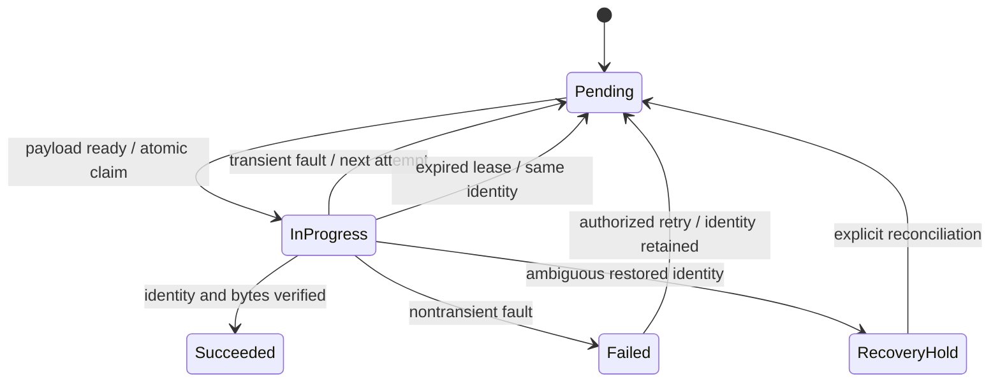

# Google Drive synchronization, backup and recovery design

Version 1.0 · November 16, 2026 · POS-DEC-001. Design only: no account connected, files uploaded, backup created or restore executed. Surely Win Dilag is sole internal owner/operator of engineering and recovery. Sources: [BRD](../Maan_and_Miggys_Beachtro_POS_BRD_v1.2.md) §§8–11,15,19,23–25; FR-023,025–029; D-11–13,17 in [decisions](DECISION_REGISTER.md).

## Consistency model and artifact contract

Local database is operational truth. Drive stores immutable off-site representations; it is not live database storage, a queue broker, a second checkout authority or an automatic import/replay source. Checkouts commit without network calls. Durable artifact intent/queue rows are inserted within the sale/correction transaction, while payload construction happens after commit.

| Artifact | Logical key / data | Folder and human filename proposal |
|---|---|---|
| Completed sale | `sale/{saleUuid}/schema1`; canonical sale snapshot JSON, including original lines/payments and policy facts | Transactions/YYYY/MM/`sale_{uuid}_v1.json` |
| Committed correction | `correction/{correctionUuid}/schema1`; original IDs, components/tender/stock disposition and audit context | Transactions/YYYY/MM/`correction_{uuid}_v1.json` |
| Daily/monthly report | `report/{runUuid}/{format}/templateVersion`; immutable ReportRun result and format version | Daily Reports or Monthly Reports/date/`sales_{range}_r{revision}_{runUuid}.csv/pdf` |
| Other report export | Same run/format identity, no overwrite on changed filters/data | Exports/`{type}_{runUuid}.{ext}` |
| Consistent backup | `backup/{backupUuid}/schemaVersion`; verified package/manifest | Database Backups/YYYY/MM/`pos_backup_{utc}_{uuid}.zip` |

Human folder/naming convention is recommended D-11/17 policy, not identity or uniqueness. Root folder ID plus child IDs are stored for approved account binding; persist IDs rather than searching by name on every upload. Files are binary Drive objects, not Google Docs conversions. Payload integer amounts and exact canonical snapshot schema avoid locale ambiguity. CSV/PDF are separate report artifacts, not mutable 'append to today's file' transactions. A later schema change generates a new explicitly versioned artifact; never mutate existing sale JSON bytes.

Canonical UTF-8 JSON field names/order and serializer version are fixed. Artifact SHA-256 is computed over exact final bytes; remote MD5, if present, is an additional transport check, not a replacement identity. Files have appProperties for logical key, content SHA-256, schema version and installation ID; do not expose secrets in metadata. No file naming collisions cause overwrites.

## Materialization protocol

1. A committed financial row plus ArtifactRecords Intent is sufficient to reconstruct sale/correction JSON. A report artifact uses persisted immutable ReportRun result, template/fonts/assets, not today's live query. Every source includes serializer/template version; incompatible regeneration is held for supported reader, not silently reserialized.
2. Write bytes to a new temporary file under controlled artifact directory; ensure canonical path stays under root. Flush, compute checksum/size and atomically rename to content-specific final path on same volume. No temporary or partially written file is uploaded.
3. In a short DB transaction, set artifact Ready with immutable path/hash/size and release queue Pending. Crash after rename/before DB update is reconciled by source key and byte hash; orphan temporary files are cleaned only after no job references them.
4. If missing after Ready, regenerate only if identical source+serializer/assets reproduce stored SHA-256. A mismatch becomes Failed/RecoveryHold with actionable diagnostic; never overwrite an existing logical key with different content. A backup file cannot be regenerated from a newer database under the old backup identity.

Original queue entry exists immediately after checkout commit even if materializer is offline or disk later fills. A post-commit materialization failure cannot erase a sale. Before new checkouts, monitor free disk and ability to persist mandatory ledger/journal; if local integrity cannot be written, stop safely. Offline-first does not mean ignoring full storage.

## Queue state machine and leases

Queue may be Pending while artifact is Intent; claim query joins only Ready payloads. One upload worker initially, lease owner random per process start, lease 120 seconds renewed every 30 seconds during long upload. Lease expiry is persisted UTC and only expired work can be reclaimed after unclean shutdown; use process-local elapsed time to avoid active lease extension errors. Large backwards clock changes set health warning and require lease/recovery review; do not concurrently claim based on untrusted clock. Mutation checks lease owner+Version so stale worker cannot acknowledge a task it no longer owns. A remote call outliving its lease still uses same remote file ID.

Workers prioritize financial JSON over reports then backups, but schedule at least one ready older backup after every 20 transaction jobs to prevent starvation. One materializer/one uploader can share a small bounded work cycle; no long lock. UI checkout has priority on write gate. Shutdown stops claims and cancels network; restart uses lease/state, not memory.

Attempt history records start/end, safe error category/HTTP code and remote ID. Success requires verified remote identity/content, not 2xx alone with missing metadata. The status screen shows last successful upload, pending+failed counts, oldest pending age, current attempt and distinct backup creation/verification/upload states. No popup per transient failure at checkout.

## Retry-safe remote creation

Before first upload, obtain a Google Drive pre-generated binary-file ID online, then **persist it locally and append it to a flushed upload-identity journal** before sending create. Journal key binds artifact logical key+SHA-256+account/root to remote ID; never reuse it for a different artifact. A crash before ID persistence creates no remote file, so an unused generated ID can be discarded. Once a create may have been sent, every retry uses the same persisted ID and bytes.

Use multipart for small content or resumable upload for larger backups as supported by the official client. Persist remote ID independently from ephemeral resumable session URL; if session expires restart using same identity. On timeout/5xx/unknown response: GET that exact ID, compare appProperties/logical identity, checksum and size; if exact match, acknowledge Succeeded. For large/high-value backups verify downloaded bytes or trustworthy server checksum against upload bytes; SHA-256 appProperty alone is client-supplied and not proof remote bytes are correct. On conflict, inspect same ID; if mismatched identity/content, RecoveryHold, never overwrite. Google documents pre-generated IDs and retry behavior for binary files. [Official creation guidance](https://developers.google.com/workspace/drive/api/guides/create-file), [upload guidance](https://developers.google.com/workspace/drive/api/guides/manage-uploads).

Normal running deduplication is by DB logical-key uniqueness + stable remote ID + immutable content. Checksums alone do not prevent duplicate files. Restore can lose a remote mapping created after backup: recovering upload identity journal and searching appProperties/folder inventory may discover the remote object. On restore, **unknown mapping is RecoveryHold, not an automatic fresh create**. Listing/search is discovery, not a uniqueness lock or proof of absence during eventual consistency. A missing returned result does not authorize creating an object with a new ID. Surely reconciles independent journal/account evidence; ambiguous artifact remains held with alert. Do not promise exactly-once uploads after total loss of every identity source.

Changing the Drive account/root never automatically replays historical files into a new destination. Review destination binding, existing mappings, retention intent and source ownership; explicitly approve a new copy task if desired, distinguish it from an accidental duplicate. Remote deletion or replacement is an incident: do not silently upload a new file under a new ID as though nothing happened. Local records remain; explicit repair decision records reason and old/new identity.

Retry policy selected: transient network/timeout/408/429/5xx and known rate-limit reasons use full jitter `random(0,min(3600s,5s×2^min(attempt,10)))`, honor longer Retry-After where valid. No hard attempt cap for recoverable outages; capped interval prevents rapid loop. 401 attempts token refresh once, then authorization-required Failed if invalid_grant/revoked. 403 distinguish rate-limit from permission/quota; storageQuotaExceeded and missing access are visible Failed awaiting intervention. Missing local source or checksum conflict goes Failed/RecoveryHold, not transient retry. Manual authorized retry retains logical/remote IDs and content, clears actionable error after fix and schedules now. No ping check before HTTP required.

## OAuth and destination ownership

Business-controlled Google account/project/client, never a personal engineer account by default. System browser installed-app OAuth with PKCE, state validation, approved loopback callback, offline refresh access where available; do not embed webview credentials or log authorization codes. Installed-app client config is not an unextractable secret; security relies on supported flow and token protection. [Google desktop flow](https://developers.google.com/identity/protocols/oauth2/native-app).

Initial minimum scope proposal `drive.file`; create app-owned Beachtro root and subfolders under that authorized account. Existing arbitrary folder ID alone may not be accessible with that scope: authorize via supported folder-selection/access workflow or use app-created root. Do not widen to full Drive to avoid a setup issue without explicit justification. Actual consent publishing/verification obligations depend on chosen app/account/scopes; verify in live integration task. [Scope documentation](https://developers.google.com/workspace/drive/api/guides/api-specific-auth).

Protect refresh token via Windows DPAPI CurrentUser in designated Windows account, with restricted secret file ACL. Access token in memory only where practicable; never put either in DB snapshots/logs/export. Token ref points to protected file; app login users are not separate DPAPI principals. After replacement device, reauthorize; copied ciphertext is not assumed portable. If authorization unavailable, queue persists and local operations continue.

## Scheduling and backup package

In-process scheduler ticks each minute using persisted due-period keys and handles startup catch-up. Recommended daily backup after business close (or once daily while app running), daily report at explicit close, monthly report for each missing completed month on next launch. If app closed/powered off, no promise of execution; UI marks missed schedule and startup creates overdue backup before nonessential heavy tasks. No separate service introduced. Owner can later request Windows Task Scheduler/headless job if unattended powered-on execution is actually required.

Backup steps: allocate BackupId/temp directory → obtain consistent SQLite Online Backup API snapshot → close target → run integrity_check and foreign_key_check on copied DB → record schema/app/installation ID, latest sale, ledger counts/totals, source assets and journal checkpoints → package DB+required receipt assets/profile serializers/template assets plus manifest and identity-journal snapshot → checksum final package → rename final → insert verified Backups record/audit/artifact/queue. Snapshot does not contain its own future backup metadata row; external manifest reconstructs that record if needed. Interrupted incomplete package never marked verified/uploadable. [SQLite backup API](https://www.sqlite.org/backup.html).

Report snapshots/sale JSON can regenerate from DB; required static assets must be included. External backup files referenced by restored queue cannot be reconstructed from that snapshot: verify existing remote backup if ID known, otherwise mark missing/held and create a new backup under a **new** identity, not a counterfeit old file. Pending old backup cleanup is reviewed with retention policy.

Manifest fields: BackupId, schema/app/serializer/template versions, UTC creation, installation ID, archive file size/checksum (outer metadata), per-member checksum, last committed sale/request/number, per-day series checkpoint, number/upload journal checkpoint/hash, original/correction counts/totals, artifact source coverage, recovery instructions version. Check integrity and ledger constraints as separate checks; checksum detects byte corruption, not financial correctness or malicious replacement.

Retention recommendation: minimum seven completed daily local generations; protect two newest restore-verified generations, any in-use restore candidate, and pending-upload backups within approved disk budget. Cleanup based on age/count only, never because upload succeeded. If pending backlog consumes headroom, warn Surely and require retention/media decision; never silently delete last good or unsent copies. Cloud retention independent and professionally approved for records where applicable. Backup deletion does not delete local transactions.

Same-drive local copies protect logical mistakes, not device loss. Maintain an independently accessible Drive copy and recommended removable/off-device copy under business control; offline cloud lag is visible. Proposed target local RPO 24 operating hours and RTO 2 hours must be measured and accepted; off-site RPO is time since last verified independent snapshot and can exceed a day during outage. No target asserted achieved.

Initial at-rest protection: restricted ACL and Windows/device encryption where available, controlled business Drive permissions, no public share links; no custom archive cryptography. Surely must accept this exposure or select a maintained recoverable encrypted-archive solution/key-custody procedure before production if business data risk requires it. No machine-bound DPAPI-only backup encryption that makes replacement-device restore impossible. Tokens are excluded. See [security design](SECURITY_DESIGN.md).

## Restore runbook and hold conditions

1. Surely authenticates with recovery capability or controlled break-glass procedure; choose maintenance mode, pause new commands/materializer/uploader, wait for any commit, close DB connections. Mark external RecoveryInProgress before replacement. Do not accept new POS sales during recovery; any real-world fallback/manual selling requires an approved separate log/reconciliation procedure, not invented data replay.
2. Preserve failed DB, WAL/SHM as evidence when present, artifacts and all journals in a timestamped recovery directory before opening replacement. Copy using safe quiesced handling, not destructive move/delete. Record checksum/access evidence; preserve latest journal independent of stale backup contents.
3. Inspect backup manifest/checksum/source, app/schema compatibility and required assets. Restore to candidate path first; run integrity/foreign_key_check and financial/stock reconciliation queries. Reject corruption, unsupported/newer schema or missing mandatory assets. Never overwrite the only old/known-good copy.
4. Identify latest completed sale in restored DB and compare to preserved current DB, printed receipts, independent backups/Drive artifacts and real-world GCash evidence. Record lost period explicitly; no automatic import of cloud JSON to ledger. Any import/reconciliation is a separately reviewed controlled repair with stable IDs, financial fixtures and audit.
5. Reconcile **every affected active number series** against latest reliable reservation journal, cloud/printed high-water and original/current data. Require provable upper bound; mark uncertain series Blocked. Do not clear hold simply because restored max+1 is unused inside restored file. External journal from backup alone may be stale after total disk loss.
6. Restore retained stable source IDs and original installation identity. New RecoveryRun generation identifies procedure, not new printed series. Resolve Prepared checkout/correction requests before replay; external money could have moved after snapshot. Reconstitute artifact intents from immutable sources; reconcile remote mappings from independent upload journal/Drive evidence. Unknown identity stays RecoveryHold; don't re-create files with fresh IDs.
7. Replace live DB only after candidate checks pass, preserving rollback copy and maintenance marker. Reauthorize Drive with approved business account if DPAPI token unusable; cloud access failure does not prevent local resumption once financial/numbering holds are independently cleared.
8. Surely records restoration source, last verified transaction, missing/lost data, high-water evidence, held jobs, responsible actor and explicit reopen disposition. Run receipt/test-profile smoke check without inserting a fake production sale; then resume normal operations if ledger and numbering are safe. Unsynced records may remain queued; unresolved financial/series uncertainty blocks selling. Resume queue only after relevant identity holds cleared.
9. Create/verify a fresh backup of recovered state and record elapsed recovery time/data-loss window against targets. Retain recovery evidence and old files under approved retention, not indefinite uncontrolled copies.

Required drill: restore an old backup onto a replacement environment with later sales/number reservations and uploads, including lost local acknowledgment, missing token and missing payload. Demonstrate no old number reused, no automatic duplicate remote create, safe held state where evidence missing, correct original/correction/stock totals, and explicit reopening. Document measured results after implementation; none has been run during design.
