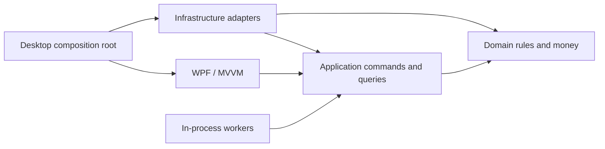

# Detailed system, module and UI design

Version 1.0 · November 16, 2026 · POS-DEC-001  
Owner/sole engineer: Surely Win Dilag. Design-selected choices and pending policies are classified in [the decision register](DECISION_REGISTER.md). Analysis is approved/closed. This document describes future implementation; it does not authorize it.

Baseline: [BRD](../Maan_and_Miggys_Beachtro_POS_BRD_v1.2.md) §§4–18,21–28, Appendices A–B; approved [architecture review](../ARCHITECTURE_REVIEW.md). Preserve Windows 11 native desktop, one initial terminal, dine-in/takeout, cash/manual GCash, finished-product inventory, receipts, offline local truth, asynchronous Drive and future terminal readiness.

## Runtime and code boundaries

One WPF win-x64 desktop process hosts the composition root, local application services and cancellable BackgroundService workers. Use .NET 10/EF Core 10 compatible maintained patches, SQLite local SSD and Serilog structured diagnostics. Pin exact versions in the first authorized dependency/build task; no installation occurs now. No initial web server, broker, distributed cache, separate Windows service or PostgreSQL instance.

Logical assemblies proposed: `Beachtro.Domain`, `Beachtro.Application`, `Beachtro.Infrastructure`, `Beachtro.Desktop`, plus unit/integration test projects when implementation is authorized. Modules are namespaces/use cases within these assemblies, not independently deployed services. Domain contains value objects and calculation/state rules; Application contains commands/queries, authorization and ports; Infrastructure implements SQLite/files/Windows/Google adapters; Desktop handles views/navigation/MVVM only. Avoid generic repository abstractions over every table; use a small checkout/correction unit of work and purpose-specific queries.

SQLite and all mutable operational files reside outside installed binaries under `%LocalAppData%\BeachtroPOS\` for the designated Windows account: `data`, `artifacts`, `backups`, `logs`, `secrets`, `recovery`. Folder paths are design contracts, not created here. Do not place the live DB under a cloud-synced folder or network share. POS users are distinct application identities even if they use the same dedicated Windows account. Switching Windows accounts requires an explicit data/DPAPI migration or reauthorization procedure.

Acquire an OS named mutex plus exclusive application-lock file for the selected data directory before opening writable mode. A second launch activates the existing window; it cannot open a second writer. Use a process-local write gate for commands and short-lived DbContext per operation. UI never retains live tracked entities. Background workers use their own scopes and yield to checkout; no DB transaction spans printer/network I/O.

Startup sequence: validate data-directory ACL/access → acquire single-instance lock → read installation identity and recovery marker → verify supported schema and DB connection pragmas → run authorized migration with pre-backup when needed → inspect unresolved checkout/print/worker state → start login/UI → start catch-up scheduler after schema is ready. `RecoveryRequired` permits only authorized recovery/diagnostics; never create a fresh empty ledger automatically when an expected DB is missing.

Shutdown stops new commands, waits briefly for active local commit resolution, cancels workers, persists already claimed job outcomes/lease state, closes DB and flushes redacted diagnostics. On forced termination, lease recovery and request idempotency supply correctness; shutdown callbacks are not a durability mechanism.

## Use-case contracts

Commands take actor/session identity from the authenticated service context, not caller-supplied user IDs. `RequestId` is stable across retry; normalized input fingerprint prevents reusing a key with changed payload. Typed results: `Success`, `Validation`, `Forbidden`, `StaleQuote`, `InsufficientStock`, `PaymentNotVerified`, `StorageUnavailable`, `BusyRetryable`, `OutcomeUnknown`, `RecoveryRequired`. Include safe field messages and correlation ID; raw exceptions/tokens never reach cashier UI.

| Module / FR | Commands / queries | Inputs, durable effects and failure contract |
|---|---|---|
| Identity FR-001–003 | SignIn, Lock, Resume, SignOut; CreateUser, ResetPassword, SetUserRoles | Normalized username and protected password processing; durable audit, failed-attempt counters and security version. No remote dependency; capability changes invalidate session snapshots. |
| Catalog FR-004–006 | SaveCategory, SaveProduct, SetActive; SearchProducts | Optimistic `Version` on mutable catalog; required SKU/name/category, positive price, unit step. Save old/new safe values to audit. Reject stale edits; archive referenced rows. |
| Inventory FR-007–008 | AdjustStock(request, product, delta, reason, expectedVersion); GetBalances/GetMovements | One transaction for on-hand/version, unique movement request and audit. Validate quantity step; negative override requires explicit capability plus reason. No automatic ingredient consumption. |
| Sales FR-009–015 | QuoteCart; PrepareCheckout; CompleteCheckout; GetCheckoutOutcome | Quote with policy/product versions; prepare durable request before external payment acknowledgment; complete validates versions/permissions and atomically persists financial facts. Never trust totals from UI. See finance design. |
| Receipts FR-016 | GetReceipt; SubmitPrint; RequestReprint | Read immutable model and template version; print job recorded before spool submission. Reprint capability/reason; no sale mutation. Physical print outcome remains operator-confirmed when driver cannot prove it. |
| History/corrections FR-017–018 | FindSales, GetSale; PrepareCorrection, CommitCorrection, GetCorrectionOutcome | Bounded filter queries; correction request saves original-line links and tender evidence; locks original aggregate against concurrent over-refund. Paid sale originals remain immutable. |
| Shifts FR-019–020 | OpenShift, RecordCashMovement, CloseShift; GetExpectedCash | Optional release feature/policy, nullable shift on sale if no required shift. One open shift per cashier; counted cash >=0, reasoned signed movement, close snapshot and variance. No reopening by silent edit. |
| Reports FR-021–023 | GetDailyDashboard, GenerateReport, ExportReport, CloseBusinessDay | One ledger-query definition; selected range uses approved business dates/UTC bounds. Persist report inputs/watermark/version and immutable content for exports. Long queries bounded/cancellable; no write lock while rendering PDF. |
| Audit/settings FR-024,029 | GetAudit; CreatePolicyVersion, SchedulePolicy, SaveBusinessProfile | Capability/re-auth sensitive changes, structured validation, reject overlapping effective policy versions. Only prospective changes; historical profile rows and snapshots retained. |
| Sync FR-026–027 | RetryArtifact, ConnectDrive, DisconnectDrive; GetSyncStatus | Manual retry resets next-attempt/error state, never remote identity/content. Disconnect revokes local use/clears token with audit; queued business records retained. |
| Backup FR-028 | CreateBackup, VerifyBackup, BeginRestore; GetBackupHealth | Consistent DB copy, checksum/manifest, maintenance-only restore; pause workers, validate candidate and number-series evidence. No overwrite of original without recoverable copy. |
| Migration readiness FR-030 | Architectural constraints and documentation | Stable UUIDs, command DTO boundaries and no UI EF dependencies. Central API/server and multi-terminal offline stock policy are future scope. |

## Order and operational states

Editable cart is UI state; an optional local Draft snapshot stores recovery data, not revenue or reserved stock. Preparing payment creates `CheckoutRequest.Prepared` with frozen quote/request identity, but does not complete an Order. Awaiting-payment UI corresponds to a prepared request. Cart edits after prepare invalidate it and create a new request/quote; do not change a prepared fingerprint.

`CheckoutRequest`: Prepared → Completed(order link), or Prepared → Abandoned. A crash after receiving GCash can leave Prepared with external money received; it must remain visible for reconciliation rather than auto-abandoning. A completed Order remains `Completed`; displayed `PartiallyRefunded`, `FullyRefunded`, `Voided` are derived from linked corrections. Cancelled drafts never become financial rows. This refines the BRD's suggested lifecycle while preserving immutable completed records (§14).

Mode: Normal / Locked / Maintenance / RecoveryRequired. Locked mode stops new protected commands, not a commit already started. On resume show persisted outcome of in-flight request before exposing new checkout. Maintenance blocks all financial/catalog writes and pauses worker claims; recovery follows its explicit runbook.

## UI/UX specification

Use WPF responsive grid for 1366×768 reference screen, 44×44 minimum primary touch targets, readable high-contrast text, focus indicators and keyboard traversal. Labels expose payment method, amount and status without relying on color alone. Monetary entry uses currency-specific decimal validation, not locale-dependent free-form parsing. Numeric quantity/price controls prevent exponent notation and invalid scale. These are design targets under D-15; actual-device validation remains required.

Shell navigation: POS, Dashboard, Orders, Products/Categories, Inventory, Reports, Shifts, Sync, Settings/Users. Capability-filtered navigation is convenience; services independently authorize. Persistent header shows operator, business date, lock action, local-storage health and sync indicator. A network outage displays informational queued status rather than blocking checkout. Disk/write faults use prominent blocking messages only for actions that cannot safely commit.

| Screen | Layout and actions | Validation, empty/error and recovery states |
|---|---|---|
| First run/login | Local owner bootstrap only on genuinely new installation; username/password and lock/resume | Generic sign-in failures, cooldown remaining, no default password. Missing expected DB invokes recovery, not bootstrap. |
| POS | Left categories/search/product buttons; right cart, Dine-in/Takeout toggle, totals and payment action; no table map | Cart shows quantity, unit price, discount/tax details, total. Default order type must be explicitly selected or confirmed. Unavailable/deactivated product and changed quote require acknowledgement. |
| Payment modal | Fixed summary/total, Cash or GCash; numeric tender/change or verifier checkbox/reference; Confirm | Disable repeated click but rely on request idempotency. Cash underpayment rejected. GCash requires explicit real-world verification. No connection to Drive required. On uncertain outcome show request reference and Recover outcome, not Pay again. |
| Completed sale | Transaction number, tender/change, print status, New order and Reprint | New order only after resolved completion. Print failure offers retry/reprint; no second sale. Development specimen clearly marked. |
| Orders | Transaction/date/status/cashier filters; paged 100-row results; item/payment/correction timeline | Default today, bounded date range; empty state. Reasoned privileged refund/void modal shows remaining quantities/value, same-tender evidence and return/discard choice. |
| Product/category editor | SKU/name/category/price/unit step/track stock/active; separate stock adjustments | Inline field errors and stale-version reload. Changing TrackStock requires audited initialization/reconciliation, not silent zero reset. |
| Inventory | Stock/reorder table; product movement drawer and signed adjustment | Mandatory reason/permission, preview resulting balance; negative-stock override warning and separate authorization. |
| Reports/dashboard | Explicit gross/net/tax/refund labels, business-date range/payment split; preview and CSV/PDF | Label data watermark and revision; no-data totals zero, not error. Generated file failure preserves request and lets retry; reports with synthetic tax marked test. |
| Shifts | Opening balance; live expected cash; movement history; counted close/variance | Opening/closing reasons and confirmation, no automatic closure. If optional shift disabled explain unavailable feature without blocking POS. |
| Sync/backup | Last success/backup, pending/failed count, oldest backlog, per-item error; retry/connect/backup controls | Distinguish offline, authorization required, quota, missing local file and recovery conflict. Success means acknowledged verified artifact, not simply attempted. |
| Settings/users | Tabbed business/profile/tax/printer/backup/Drive/identity | Tax Unknown shown explicitly; production activation checklist requires approval evidence. Owner/admin capabilities separate; last owner cannot be disabled. Test print does not create financial sale. |
| Recovery | Backup candidate metadata, last sale, integrity result, known numbering evidence, token reconnect and recovery record | Only Surely's recovery capability; explicit destructive-replacement confirmation, retain old copy. Unresolved series blocks sale reopening even if DB passes integrity. |

Keyboard proposal: Ctrl+F product search, Enter select highlighted product, F4 payment, Esc dismiss noncommitting modal, Ctrl+L lock. No single key silently completes payment or refunds. Screen-reader names and validation summaries follow control labels. On lock preserve prepared request; switching cashier never transfers ownership of a prepared payment without reconciliation/audit. Cancelled unprepared cart may be discarded with confirmation; persisted prepared request must be resolved or explicitly abandoned by authorized operator.

## Deployment and future boundary

Select self-contained .NET 10 win-x64 with Windows Installer, offline install and manually controlled updates. Surely owns dependency/license review, signing/trust and patch servicing. Print uses installed Windows drivers; PDF rendering library choice is a small future dependency decision with license check, not an architecture gate. No auto-updater/service introduced.

Upgrade: exit app → verify package/source/version → take and verify pre-migration backup → install binaries → apply tested forward migration in maintenance mode → integrity/financial smoke checks → record version/audit → reopen. If migration fails, preserve files and roll back with the compatible binary+verified backup pair, subject to numbering/sales reconciliation. Never run an old binary against a newer unsupported schema or use uninstall to delete operational data.

Future terminals move application use cases behind a central API with server DB, stable IDs and explicit cutover strategy. DTOs do not expose EF tracked entities. Price/stock concurrency, legal numbering, central identity and disconnected terminal conflict rules require a separate approved design; initial offline behavior is not a distributed replication claim.
